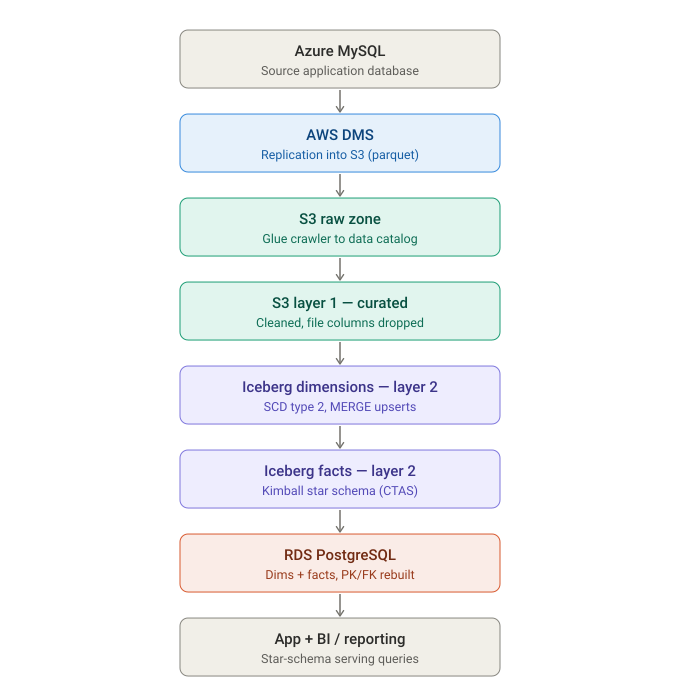
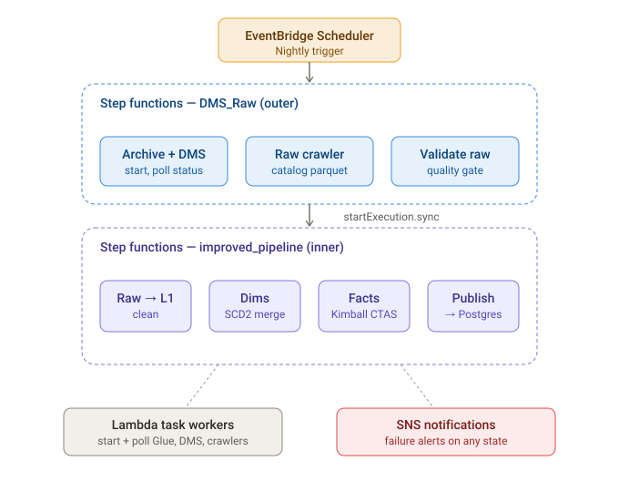

# Public-sector data lakehouse — architecture case study

An end-to-end AWS data lakehouse that ingests a production operational database nightly, refines it through a medallion (multi-hop) architecture, models it into a Kimball star schema on Apache Iceberg, and serves it from PostgreSQL. It ran unattended in production from August 2025 to August 2026, processing roughly **750,000 records per nightly run**.

> **Status:** The production pipeline stopped running in August 2026 and is no longer active. This write-up describes the system as it ran during that period.

The infrastructure-as-code reconstruction of this pipeline is public: **[datalakehouse-infra](https://github.com/Kiveshan/datalakehouse-infra)** (Terraform + Glue/Lambda source). It is a from-scratch Terraform build of the same design, written against a fresh AWS account rather than a live cutover of the client's environment — see [What I would improve](#what-i-would-improve) for how it relates to the production system described here.

**Stack:** AWS DMS · S3 · Glue (PySpark) · Apache Iceberg · Step Functions · EventBridge Scheduler · Lambda · SNS · RDS PostgreSQL · `af-south-1`

> **No source code in this repository.** This system was built for a paying client under confidentiality. This repo is an architecture write-up only — diagrams, design decisions, and trade-offs. No scripts, credentials, schemas, or client data are included. See [Why there is no code here](#why-there-is-no-code-here). The linked [datalakehouse-infra](https://github.com/Kiveshan/datalakehouse-infra) repo is a separate, from-scratch Terraform reconstruction of the same design against a fresh AWS account — it contains no client schema, data, or credentials either.

---

## Context

The client is a South African public-sector skills-development authority. Their operational platform runs on a managed Azure Database for MySQL behind a web application. They needed analytical reporting — historical trend analysis, compliance reporting, and sector-wide aggregations — that could not be run against the live transactional database without degrading the application.

The problem was the classic one: a normalised, highly relational OLTP schema (hundreds of tables) is the wrong shape for analytics, and querying it directly competes with production traffic. The brief was to stand up a separate analytical layer, refreshed nightly, that preserves point-in-time history and presents a query-friendly model — without a dedicated data team to operate it.

## Outcome

- A lakehouse refreshed **nightly, unattended**, in production from August 2025 to August 2026.
- ~**750,000 records** ingested per run from the Azure MySQL source.
- Full SCD Type 2 history for **353 source tables**, 47 of them modelled into a Kimball star of **14 fact tables** and **15 conformed dimensions**.
- **Zero manual steps** in the steady state: a single scheduled trigger runs ingestion, transformation, modelling, and publishing, with automatic retries and failure alerting.
- Analytical load fully isolated from the production OLTP database.

## Architecture

The data plane is a medallion architecture: raw data lands untouched, then is progressively cleaned and modelled across discrete layers, each materialised in S3.



1. **Source — Azure MySQL.** The live operational database, owned by the client's application.
2. **Ingestion — AWS DMS.** Database Migration Service replicates the source tables into an S3 raw zone as parquet. A Glue crawler catalogs the raw zone into the Glue Data Catalog so it is queryable and discoverable by downstream jobs.
3. **Layer 1 — curated (S3).** A PySpark Glue job cleans the raw tables: it standardises types, and removes document/file-path columns that carry no analytical value (and that would otherwise leak storage references into the warehouse). Output is parquet under a `curated/layer1/` prefix.
4. **Layer 2 — dimensions (Iceberg).** A nightly SCD Type 2 job builds and maintains dimension tables as Apache Iceberg tables, using `MERGE` to close changed rows, expire deleted rows, and insert new/changed versions — preserving point-in-time history.
5. **Layer 2 — facts (Iceberg).** Fact tables are built as a Kimball star schema using `CREATE TABLE AS SELECT`, joining to dimensions on surrogate keys and resolving a shared date dimension and status dimension.
6. **Serving — RDS PostgreSQL.** Publishing jobs mirror the Iceberg dimensions and facts into PostgreSQL, rebuilding primary and foreign key constraints so the serving layer is a fully relational, referentially-intact star schema.
7. **Consumers.** The application's reporting features and BI queries run against the Postgres star schema, never against the source OLTP database.

See [docs/architecture.md](docs/architecture.md) for the per-layer detail, including the data-quality gate and the identifier-safety handling in the publish step.

## Orchestration

The control plane is a two-level Step Functions design that separates **ingestion** from **transformation**. This separation matters: ingestion (DMS + crawling) has very different failure modes and timing characteristics from the transformation jobs, and keeping them in distinct state machines keeps each one small and independently testable.



- **EventBridge Scheduler** fires the pipeline nightly.
- The **outer state machine** archives the previous raw data, starts DMS, polls until replication completes, runs and polls the raw crawler, then runs a **data-quality gate** before going further. It then invokes the inner machine synchronously (`startExecution.sync`) so the outer execution reflects the true end-to-end status.
- The **inner state machine** runs the Glue jobs in strict sequence: raw → layer 1 → dimensions → facts → publish-to-Postgres. Each step follows a `start → wait → check → choice` polling loop, with exponential backoff, jitter, and retry limits.
- **Lambda functions** — nine of them — are the task workers that start and poll Glue jobs, DMS, and crawlers.
- **SNS** sends a failure notification from any failed state, so a broken run is surfaced rather than silently producing stale data.

## Data model

The warehouse is a deliberate Kimball star schema, not a flattened dump:

- **Dimensions** carry surrogate keys (`*_sk`) and full SCD Type 2 versioning (`effective_from`, `effective_to`, `current_flag`), so a fact can be analysed against the attribute values that were true at the time of the event.
- **Conformed dimensions** — a single `dim_date` and a single `dim_status` — are shared across every fact, so reporting is consistent across subject areas.
- **Facts** reference dimensions by surrogate key and are published to Postgres with real foreign-key constraints, which both documents the model and catches referential breaks early.

## Tech stack

| Concern | Choice |
| --- | --- |
| Source extraction / CDC | AWS DMS |
| Object storage | Amazon S3 (parquet) |
| Table format (warehouse) | Apache Iceberg (format v2) |
| Transformation engine | AWS Glue (PySpark / Spark SQL) |
| Cataloging | Glue Data Catalog + Glue crawlers |
| Orchestration | AWS Step Functions (nested) |
| Scheduling | Amazon EventBridge Scheduler |
| Task workers | AWS Lambda |
| Alerting | Amazon SNS |
| Serving database | Amazon RDS for PostgreSQL |

## Architecture decisions

Every component here was chosen against a real alternative. The full ADR set is in [docs/decisions.md](docs/decisions.md); this section covers the questions that get asked most.

### Why AWS Glue for transforms rather than Lambda?

Lambda is the wrong shape for this workload, on three separate axes:

- **Compute model.** The heavy steps are distributed joins across several hundred tables, an Iceberg `MERGE` maintaining SCD Type 2 history, and `CREATE TABLE AS SELECT` fact builds resolving surrogate keys. That is a Spark workload. Lambda is single-node with a 10 GB memory ceiling — you would end up sharding the work across invocations by hand and rebuilding a scheduler and a shuffle, badly.
- **Execution time.** Lambda hard-stops at 15 minutes. The nightly transform steps run well past that, and the failure mode is not a slow job — it is a *truncated* one. A timeout mid-`MERGE` on a dimension is exactly the corruption the Iceberg design exists to prevent.
- **Ecosystem fit.** Glue reads the Glue Data Catalog the crawler populates, ships the Iceberg runtime natively, and writes parquet to S3 without glue code. On Lambda all of that is a dependency-packaging problem.

**The trade-off I accepted.** Glue jobs have a startup cost of roughly a minute or two and bill per DPU-hour with a minimum billing duration, so Glue is genuinely wasteful for small, fast work. That is not a hypothetical — it is why **Lambda is still in this architecture**, as the task workers that start and poll DMS, crawlers, and Glue jobs. Those calls are sub-second, stateless, and run dozens of times per night. The decision was never "Glue *or* Lambda"; it was *distributed transforms on Glue, control-plane API calls on Lambda*.

**What else was on the table.** EMR gives more engine control and better economics at sustained scale, but it adds cluster lifecycle management to a client with no data team. Glue Python Shell jobs avoid Spark startup cost, but then you are back to single-node. Glue was the right point on the curve for one nightly batch of ~750k records.

### Why Step Functions for orchestration rather than Airflow?

The honest primary driver is **operational cost of ownership**. The client has no data engineering team; whatever orchestrates this has to survive without anyone tending it.

- **Nothing to keep running.** MWAA (managed Airflow) bills for an always-on environment whether or not a DAG fires. This pipeline runs *once a night*. Step Functions bills per state transition, which at this cadence rounds to nothing, and EventBridge Scheduler replaces the scheduler process entirely.
- **Retries are configuration, not code.** Exponential backoff, jitter, bounded retry counts, and `Catch` blocks routing to SNS are declared in the state machine definition. In Airflow a meaningful share of that becomes operator arguments plus custom callback code that has to be tested.
- **Execution history is the audit trail.** Every run's inputs, outputs, and per-state timings are retained and inspectable without standing up logging infrastructure or a metadata database. For a compliance-adjacent public-sector workload, "show me exactly what last Tuesday's run did" is a real question with a first-class answer.
- **Managed IAM boundaries.** Each state assumes a role. There is no worker fleet holding broad credentials.

**The trade-off I accepted.** Amazon States Language is verbose and awkward to test locally — there is no clean equivalent of running a DAG on your laptop, and iteration means deploying. Airflow's Python-native authoring, backfill semantics, and dependency graph are genuinely nicer *if you already operate Airflow*. I did not, and neither did the client. Step Functions also caps execution history events on Standard workflows, which is a real constraint if you ever fan out per-table — the fixed-sequence design here stays far below it.

**What else was on the table.** A cron-triggered Lambda chaining the next job on each completion. Cheapest possible option, and the reason it lost is that failure handling, partial re-runs, and "where did last night's run stop?" all become bespoke code with no state model behind them.

### Why nested state machines instead of one?

Ingestion and transformation fail differently and on different timescales. Splitting them keeps each definition small, makes the transformation half re-runnable on its own when ingestion already succeeded — the single most common real-world recovery action — and isolates blast radius. The outer machine invokes the inner one with `startExecution.sync`, so the outer execution's status is still the true end-to-end status. The cost is two definitions to maintain instead of one.

### Why Iceberg rather than plain parquet?

Iceberg provides ACID writes, snapshot isolation, and schema evolution. That is what makes a nightly SCD Type 2 `MERGE` safe to run unattended: it either fully applies or does not, so a mid-run failure cannot leave a dimension half-updated. Schema evolution matters because the source OLTP schema changes over time and the warehouse must absorb that without a full rebuild. Plain parquet directories would mean hand-rolling atomicity, and the failure mode is silent history corruption. The cost is new operational concepts — snapshots, metadata files, table maintenance.

### Why mirror to PostgreSQL rather than query Iceberg directly?

The consuming application already speaks SQL to Postgres. Mirroring the modelled star schema into RDS — with PK/FK constraints rebuilt — gives the app a familiar, low-latency, referentially-intact target without coupling it to the lake's query engine or its cold-start characteristics. Athena over Iceberg would have removed a copy step and a database to operate, at the cost of per-query billing, higher and less predictable latency, and rewriting the application's data access layer. The trade-off is a copy step and two stores to keep in sync, which the nightly cadence makes acceptable.

### Why DMS rather than a Glue JDBC extract?

DMS is purpose-built for reading a live OLTP database without holding long-running transactions against it — the entire premise of the project is not degrading the client's production application. It lands parquet in S3 with no bespoke connector code and no extraction logic to maintain as the source schema drifts. The trade-off is a replication instance that costs money whether or not it is replicating, and the current design does a nightly full load rather than true CDC; moving to CDC is the obvious lever if source volume grows.

### Why nightly batch rather than streaming?

The requirement is historical trend analysis, compliance reporting, and sector aggregations. None of it is improved by sub-daily freshness, and streaming would multiply both cost and operational surface for no benefit the users would notice. Up to 24 hours of staleness is an accepted, documented property of the system, not an oversight.

### Why `af-south-1`?

Data residency. This is South African public-sector data with POPIA obligations, and the source system is already in-country — keeping the analytical copy in Cape Town avoids a cross-border transfer question entirely, and keeps latency to the client's users low. The trade-off is real: `af-south-1` has a smaller service catalogue, higher unit pricing than `us-east-1`, and new AWS features land there late. That is the right price to pay for not having to argue about where the data physically sits.

### Why SNS alerting rather than a monitoring stack?

The operational requirement is "a failed run must not be discovered as a stale dashboard the next morning." An SNS notification wired from every failed state meets that requirement completely. CloudWatch dashboards, anomaly detection, or a paging tool would be more capable and would also be infrastructure nobody at the client is positioned to maintain. Right-sizing the ops surface to the team that inherits it is itself a design decision.

## What I would improve

Being honest about the trade-offs is part of the point of this write-up.

- **Replace polling Lambdas with native Step Functions service integrations.** Much of the orchestration polls Glue jobs and crawlers through Lambda workers. Step Functions supports `.sync` integrations for Glue jobs and SDK integrations for DMS and crawlers, which would remove most of those Lambdas and their cold-start and status-parsing overhead.
- **Confirm and codify incremental load at layer 1.** The SCD Type 2 step is incremental; the upstream cleaning step should be audited to ensure it is not reprocessing unchanged tables in full every night, which is the obvious cost lever as the dataset grows.
- **Infrastructure as code.** The production system described above was provisioned through the console and SDK over time, not IaC. I've since rebuilt the design as Terraform in **[datalakehouse-infra](https://github.com/Kiveshan/datalakehouse-infra)** — remote state, a self-contained DMS module, and all nine orchestration Lambdas and Glue jobs as code — but that build targets a fresh AWS account, not the client's environment, and hasn't been run against real data (the `build_etqa_facts` join logic in particular is flagged there as an unverified placeholder pending a real crawl). It demonstrates the reproducible shape this pipeline should have had from the start; cutting the actual client environment over to it is separate, unstarted work.

## Why there is no code here

The pipeline scripts running against the client's actual account contain client-specific schema, table mappings, connection details, and business logic that belong to the client. Publishing them would expose confidential information and infrastructure detail. A redacted code dump also reads worse to an engineer than a clear architecture write-up: the value of this project is the *design* — the layering, the history-preservation strategy, the orchestration model — and that is exactly what this repo communicates. The diagrams here are reconstructions that contain no account identifiers, endpoints, ARNs, or credentials.

What *is* published is [datalakehouse-infra](https://github.com/Kiveshan/datalakehouse-infra) — the same design rebuilt as Terraform from scratch against a fresh, non-client AWS account, with generic table names and no client data anywhere in it. That repo is the place to see actual Terraform, Glue PySpark, and Lambda source; this one is the place to see why each choice was made.

## Repository structure

```
.
├── README.md                  this case study
├── docs/
│   ├── architecture.md        per-layer detail + control plane
│   └── decisions.md           design decisions with trade-offs (ADR style)
└── diagrams/
    ├── data-lineage.svg       source-to-serving data flow
    └── orchestration.svg      nested Step Functions control plane
```
